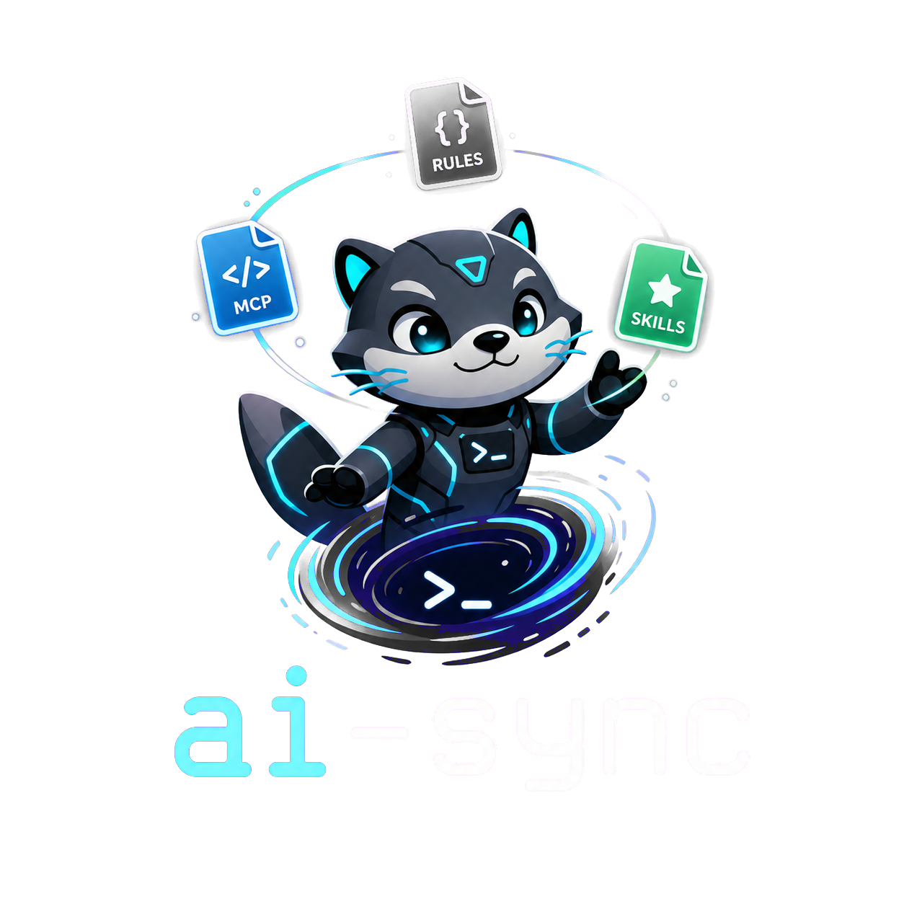

# 🔄 ai-sync

<p align="center">
  
</p>

<p align="center">
  
  
  
</p>

`ai-sync` is a Go CLI that keeps AI-agent configuration in one canonical `.ai/` directory, then generates the files expected by Claude Code, Codex, and Kiro.

The [Orca extension](docs/orca-catalog.md) adds an **Open ai-sync Catalog** command for the focused worktree. The catalog can also be opened directly with `ai-sync catalog --orca .`.

For the same resource catalog in a terminal, run `ai-sync tui .`. The full-screen interface supports mouse clicks, wheel scrolling, keyboard navigation, live search, and filters by resource type. It inspects all `.ai/` resources, loads other Orca projects on request, opens source files in Orca, and reviews copies of skills or agents before applying them. Plugin actions are available from the detail panel and **Add plugin** button.

Instead of maintaining three separate sets of rules, MCP settings, and skills by hand, you edit `.ai/` once and let `ai-sync` render each agent-specific format.

## ✨ Why use it?

Use `ai-sync` when a repository needs consistent instructions across multiple AI coding agents.

| 🚧 Problem | ✅ What `ai-sync` does |
| --- | --- |
| Claude, Codex, and Kiro each expect different files | Generates the right output files for each target |
| Shared project rules drift between agents | Keeps shared guidance in `.ai/project.md` |
| Agent-specific guidance gets mixed with global rules | Keeps overrides in `.ai/targets/<target>.md` |
| Skills need to be copied into several agent folders | Copies `.ai/skills/` into each target's expected location |
| Generated files can become stale | Uses manifests to prune files it owns safely |

## 📦 Install

```sh
go install github.com/dialguiba/ai-sync/cmd/ai-sync@latest
```

Make sure Go's bin directory is in your `PATH`.

For the current terminal session:

```sh
export PATH="$HOME/go/bin:$PATH"
```

To make it permanent, add the same line to your shell config file:

| Shell | Config file | Command |
| --- | --- | --- |
| zsh | `~/.zshrc` | `echo 'export PATH="$HOME/go/bin:$PATH"' >> ~/.zshrc` |
| bash | `~/.bashrc` | `echo 'export PATH="$HOME/go/bin:$PATH"' >> ~/.bashrc` |
| fish | `~/.config/fish/config.fish` | `fish_add_path $HOME/go/bin` |

Reload your shell config after updating it:

```sh
source ~/.zshrc   # zsh
source ~/.bashrc  # bash
```

For fish, restart the terminal or run:

```fish
source ~/.config/fish/config.fish
```

Check that the CLI is available:

```sh
ai-sync --help
```

Print the `.ai/` authoring convention when you want a human or AI agent to scaffold the canonical source files for an existing project:

```sh
ai-sync convention
```

## 🔼 Update

Update `ai-sync` by running the install command again:

```sh
go install github.com/dialguiba/ai-sync/cmd/ai-sync@latest
```

Verify the installed binary:

```sh
which ai-sync
ai-sync --help
ai-sync version
go version -m "$(which ai-sync)"
```

The module path should point to `github.com/dialguiba/ai-sync`, and `ai-sync version` should match the latest release tag.

Prebuilt binaries are also attached to each GitHub Release for macOS, Linux, and Windows on `amd64` and `arm64`.

## 🚢 Releasing

Maintainers publish a new release by pushing a SemVer tag:

```sh
git tag vX.Y.Z
git push origin vX.Y.Z
```

GitHub Actions runs GoReleaser on `v*` tags and uploads archives plus `checksums.txt` to the GitHub Release.

## ⚡ Quick start

Run these commands inside the repository you want to configure:

```sh
ai-sync init        # create a starter .ai/ directory
ai-sync convention  # print the .ai authoring convention for an AI agent
ai-sync version     # print version and build metadata
ai-sync             # generate Claude, Codex, and Kiro files
ai-sync --dry-run   # preview changes without writing files
ai-sync list        # list generated file paths without writing files
ai-sync clean       # remove generated files for a fresh regeneration
```

Generate only one target when needed:

```sh
ai-sync --target claude
ai-sync --target codex
ai-sync --target kiro
```

Reset generated files when you need a fresh regeneration:

```sh
ai-sync clean --dry-run        # preview generated files that would be removed
ai-sync clean --force          # remove all ai-sync managed outputs
ai-sync clean --target kiro    # clean only one target
ai-sync clean && ai-sync       # clean, then regenerate from .ai/
```

## 🧠 Mental model

```txt
You edit this:

.ai/
  project.md
  mcp.yaml
  plugins.yaml
  hooks.yaml
  targets/
    claude.md
    codex.md
    kiro.md
  rules/
    frontend.md
    backend.md
  agents/
    comment-sicko.md
  skills/
    example/
      SKILL.md

ai-sync generates this:

Claude Code  -> CLAUDE.md, .claude/settings.json, .mcp.json, .claude/rules/, .claude/agents/, .claude/skills/
Codex        -> AGENTS.md, nested */AGENTS.md for scoped rules, .codex/config.toml, .agents/skills/
Kiro         -> .kiro/steering/, .kiro/settings/mcp.json, .kiro/powers/, .kiro/skills/
```

> [!IMPORTANT]
> The rule is simple: **edit `.ai/`, not generated files**.

## 🧾 Generation contract

| Canonical input | Claude Code output | Codex output | Kiro output |
| --- | --- | --- | --- |
| `.ai/project.md` | `CLAUDE.md` shared section | root `AGENTS.md` shared section | `.kiro/steering/project-conventions.md` shared section |
| `.ai/targets/claude.md` | `CLAUDE.md` target-specific section | — | — |
| `.ai/targets/codex.md` | — | root `AGENTS.md` target-specific section | — |
| `.ai/targets/kiro.md` | — | — | `.kiro/steering/project-conventions.md` target-specific section |
| `.ai/rules/<name>.md` | `.claude/rules/<name>.md` with `paths` frontmatter | nested `<scope>/AGENTS.md` files, or root `AGENTS.md` when no narrower directory exists | `.kiro/steering/<name>.md` with `inclusion: fileMatch` |
| `.ai/mcp.yaml` | `.mcp.json` | `.codex/config.toml` | `.kiro/settings/mcp.json` |
| `.ai/plugins.yaml` | `.claude/settings.json` (`extraKnownMarketplaces`, `enabledPlugins`, `env`) | — | — |
| `.ai/hooks.yaml` | `.claude/settings.json` (`hooks`) | — | — |
| `.ai/setup.yaml` | executed directly on every sync, regardless of `--target` (see "Setup scripts" below) | executed directly | executed directly |
| `.ai/agents/<name>.md` | `.claude/agents/<name>.md`, copied unchanged | — | — |
| `.ai/skills/<name>/SKILL.md` | `.claude/skills/<name>/SKILL.md` | `.agents/skills/<name>/SKILL.md` | `.kiro/skills/<name>/SKILL.md` and `.kiro/powers/<name>/POWER.md` |
| extra files under `.ai/skills/<name>/` | copied under `.claude/skills/<name>/` | copied under `.agents/skills/<name>/` | copied under `.kiro/skills/<name>/` and `.kiro/powers/<name>/` |

`ai-sync list` prints this generated-file contract for the current repository without writing files. Use `ai-sync list --target codex` when you only want one target.

## 🛠️ Authoring `.ai/`

### 🌍 Shared project guidance

Put repo-wide instructions in `.ai/project.md`.

Good examples:

- 🏗️ stack and architecture conventions
- 🧪 build, test, lint, and verification commands
- 🧼 naming, formatting, and import rules
- 📝 commit conventions
- 👀 review expectations
- 🧾 generated-file ownership rules

Example:

```md
# Project Rules

## Commands

- Run tests with `go test ./...`.
- Format Go code with `gofmt`.

## Conventions

- Use conventional commits.
- Do not edit generated agent files directly; update `.ai/` instead.
```

### 🎯 Target-specific guidance

Use `.ai/targets/<target>.md` only for instructions that apply to one agent.

| 📄 File | 🎯 Use for |
| --- | --- |
| `.ai/targets/claude.md` | Claude Code-specific behavior or wording |
| `.ai/targets/codex.md` | Codex-specific workflow, planning, or review instructions |
| `.ai/targets/kiro.md` | Kiro-specific steering guidance |

If the same rule appears in more than one target file, it probably belongs in `.ai/project.md` instead.

List generated file paths without writing files:

```sh
ai-sync list
ai-sync list --target codex
```

### 🧭 Path-scoped rules

Use `.ai/rules/<name>.md` for guidance that should apply only to specific files or directories. Each rule file must start with YAML frontmatter containing a `paths` list.

Example `.ai/rules/frontend.md`:

```md
---
paths:
  - "frontend/**"
  - "src/**/*.tsx"
---

# Frontend Rules

- Use atomic design for UI components.
- Keep container logic separate from presentational components.
```

`ai-sync` maps these rules to each target's strongest supported mechanism:

| Target | Generated output |
| --- | --- |
| Claude Code | `.claude/rules/<name>.md` with `paths` frontmatter |
| Kiro | `.kiro/steering/<name>.md` with `inclusion: fileMatch` and `fileMatchPattern` |
| Codex | Root `AGENTS.md` for base guidance plus nested `<scope>/AGENTS.md` files for path-scoped rules |

For Codex, `ai-sync` maps each glob to the nearest stable directory before the first glob segment. For example, `frontend/**` generates `frontend/AGENTS.md`, and `src/**/*.tsx` generates `src/AGENTS.md`. Root-only patterns such as `*.go` stay in the root `AGENTS.md` because Codex has no more specific directory to attach them to.

### 🔌 MCP servers

Define shared MCP servers in `.ai/mcp.yaml`:

```yaml
servers:
  playwright:
    command: npx
    args:
      - -y
      - '@playwright/mcp@latest'
    env:
      PLAYWRIGHT_HEADLESS: "true"
  docs:
    url: https://example.com/mcp
    bearer_token_env_var: DOCS_TOKEN
```

`ai-sync` maps that config to each agent's expected file:

| 🧩 Canonical source | Claude | Codex | Kiro |
| --- | --- | --- | --- |
| `.ai/mcp.yaml` | `.mcp.json` | `.codex/config.toml` | `.kiro/settings/mcp.json` |

> [!WARNING]
> Do not put secrets directly in `.ai/mcp.yaml`. Reference environment variables instead.

Use `command` for a local stdio server or `url` for a remote HTTP server. `bearer_token_env_var` names an environment variable available to each agent process. See [MCP lifecycle examples](docs/agents/ai-resources.md#mcp-server).

### 🧩 Claude Code plugins

Declare plugin marketplaces and the plugins to enable in `.ai/plugins.yaml`. The file is optional.

```yaml
marketplaces:
  mattpocock:
    repo: mattpocock/skills
  ponytail:
    repo: DietrichGebert/ponytail
plugins:
  mattpocock-skills@mattpocock: true
  ponytail@ponytail: true
env:
  PONYTAIL_DEFAULT_MODE: "off"
```

For a GitHub marketplace, resolve its packages once before generating all targets:

```sh
ai-sync plugins sync .           # fetch, pin and prepare; does not install anything
ai-sync                         # generate project resources and install missing Claude plugins
ai-sync plugins sync . --update  # explicitly move marketplace pins to their remote HEAD
```

The declaration remains in `plugins.yaml`. Resolution writes `.ai/plugins.lock.yaml`
with the exact commits and content hashes and retains the packages under `.ai/plugins/`.
Commit both with the canonical configuration to allow offline generation on another
machine. If the package folders are absent, `plugins sync` restores the locked commits.
After updating, run `ai-sync` to regenerate project resources and `ai-sync plugins`
to reinstall Claude packages; the automatic Claude check does not upgrade existing installs.

Resolved marketplaces use the pinned local checkout for Claude. For Codex and Kiro,
ordinary generation copies the skills selected by the plugin manifest, including nested
paths, and projects its supported MCP servers into each project's configuration. Names
are qualified as `<plugin>-<resource>`. Plugin resources retain their plugin ownership;
they are not imported as standalone declarations into `.ai/skills/` or `.ai/mcp.yaml`.
Referenced Claude agent instructions are bundled with skills. Hooks, commands, native
agents and other components without an adapter remain in the Claude package and are
reported explicitly for Codex/Kiro.

`--dry-run`, inventory, preview and ordinary generation never fetch plugin packages.
An unresolved remote plugin produces a message pointing to `plugins sync` during sync.
Compatible prepared packages also appear in `plugins preview/apply`; installation
there remains explicit. See [remote plugin resolution](docs/portable-plugins.md#remote-plugin-resolution).

Each plugin key is `<plugin>@<marketplace>`, the same form `claude plugin install` takes, and its value is the enabled flag. A marketplace takes `repo` for GitHub, `url` for a hosted manifest, or `path` for a local checkout. `source` is inferred from whichever one you set, so declare it explicitly only to override that.

`env` becomes the `env` block of `.claude/settings.json`. Plugins that read their configuration from the environment, such as `PONYTAIL_DEFAULT_MODE`, are configured there.

| 🧩 Canonical source | Claude | Codex | Kiro |
| --- | --- | --- | --- |
| `.ai/plugins.yaml` | `.claude/settings.json` | — | — |

> [!IMPORTANT]
> `ai-sync` owns all of `.claude/settings.json`, so it is the only place project-scoped plugins survive a sync. Installing with `claude plugin install --scope project` writes to that same file and the next sync overwrites it.

Rendering `enabledPlugins` sets the enabled flag, but it does not put the plugin on disk by itself. Claude Code loads a plugin from `~/.claude/plugins/installed_plugins.json`, which pins the installed version and commit and is global to the machine, so no file under `.ai/` can hold it.

Plain `ai-sync` closes that gap on its own: after writing `.claude/settings.json`, it checks `~/.claude/plugins/installed_plugins.json` for each enabled entry and runs `claude plugin install <plugin>@<marketplace> --scope project --yes` for whichever ones are missing. The check is a local file read — no network, no `claude` invocation — so a steady-state sync where everything is already installed costs nothing extra. If `claude` isn't on `PATH` at all, the check is skipped silently rather than failing the sync (a machine that only uses `ai-sync` for Codex or Kiro output never needs Claude Code installed).

```sh
ai-sync    # writes .claude/settings.json, then installs whatever it just enabled that isn't on disk yet
```

Use the explicit `ai-sync plugins` command instead when you need something the automatic check does not do — a scope other than `project`, or forcing a reinstall/upgrade (the automatic check only asks "does this key exist at all," not "is it current"):

```sh
ai-sync plugins --dry-run          # print the commands without running them
ai-sync plugins --scope user       # project (default), user, or local
```

Entries set to `false` are reported as skipped instead of installed, in both the automatic check and the explicit command. A failed install no longer aborts the rest — every declared plugin gets attempted, and every failure is reported together at the end.

For project-scoped lifecycle operations, use `ai-sync plugins add`, `status`, `updates`, `update`, and `remove`. The add, update, and remove commands currently manage Claude marketplace plugins; `status` also shows declared Codex and Kiro variants. The `manage-ai-resources` skill covers plugins, skills, rules, and MCP servers. See [resource management](docs/agents/ai-resources.md) for examples and [plugin lifecycle](docs/agents/plugin-lifecycle.md) for plugin update states.

Run `ai-sync plugins tui .` for a terminal menu that lists plugin status, manages Claude project plugins, and previews or applies declared Codex and Kiro variants. It uses the existing CLI operations without opening the browser catalog.

### 🪝 Hooks

Declare Claude Code hooks in `.ai/hooks.yaml`. The file is optional and only the Claude target reads it. The shape matches Claude Code's native `hooks` block in `.claude/settings.json` directly — a map from event name to a list of matchers, each with one or more commands. `ai-sync` renders whatever event names you put here verbatim; it does not validate them against Claude Code's actual event list, so a typo (or a name copied from a plugin's own `hooks.json`, which can define convenience event names that only work inside a plugin manifest) fails silently as an "unknown hook event... ignored" warning the next time Claude Code loads the file. Use only real native events — `PreToolUse`, `PostToolUse`, `SessionStart`, `SessionEnd`, and friends; run `claude` and trigger a settings warning to see the current full list.

```yaml
SessionStart:
  - hooks:
      - type: command
        command: "code-review-graph status || true"
PostToolUse:
  - matcher: "Write|Edit"
    hooks:
      - type: command
        command: "code-review-graph update 2>/dev/null || true"
  - matcher: "Bash"
    hooks:
      - type: command
        command: "cat | grep -q 'git commit' && code-review-graph update 2>/dev/null; true"
```

There is no native "after a git commit" event — `PostToolUse` matches on tool name only, so a `Bash` matcher fires on every shell command. The `Bash` entry above reads the hook's stdin JSON (which carries `tool_input.command`) and greps it for `git commit` itself, since the matcher cannot filter by command content; `code-review-graph update` is incremental and cheap, so a false-positive match on some other `Bash` call is harmless.

This is how a tool that used to ship as a plugin, or that self-installs by writing straight into `.claude/settings.json`, gets absorbed back into the canonical source: write down the hooks it needs once in `.ai/hooks.yaml`, and `ai-sync` regenerates them on every sync instead of a one-off installer script owning that part of the file.

| 🧩 Canonical source | Claude | Codex | Kiro |
| --- | --- | --- | --- |
| `.ai/hooks.yaml` | `.claude/settings.json` | — | — |

> [!WARNING]
> Do not put secrets directly in `.ai/hooks.yaml`. Reference environment variables instead.

> [!IMPORTANT]
> Same rule as plugins: `ai-sync` owns all of `.claude/settings.json`. A hook written there by an external installer does not survive the next sync unless it is also declared in `.ai/hooks.yaml`.

### ⚙️ Setup scripts

Declare per-machine bootstrap commands in `.ai/setup.yaml`. Every entry here runs on every plain `ai-sync` invocation — there is no separate command to remember:

```yaml
code-review-graph:
  check: "command -v code-review-graph"
  install: "pip install code-review-graph"
```

For each entry, `ai-sync` runs `check` first. If it exits `0`, the entry is already satisfied and `install` never runs. If it exits non-zero, `ai-sync` runs `install`. `check` must be cheap — it runs unconditionally on every sync, so a slow check makes every sync slow. `install` only pays its cost once, the first time a machine is missing the tool.

This is how a tool that used to self-install by writing into agent config directly, or that requires a manual one-time `pip install` a teammate would otherwise have no way to discover, gets folded back into `ai-sync`: write the check/install pair once, commit it, and every clone of the repo bootstraps itself on the next sync.

> [!WARNING]
> `check` and `install` are shell commands (`sh -c`) declared in a file that ships with the repo. Review changes to `.ai/setup.yaml` in code review exactly as you would review any other script — a bad entry runs on every teammate's machine on their next `ai-sync`.

`--dry-run` reports `would install <name>` instead of running `install`. A failing `install` stops the run and returns a non-zero exit, but files already generated earlier in the same `ai-sync` run stay on disk.

### 🧰 Skills

Put reusable workflows in `.ai/skills/<name>/SKILL.md`:

```txt
.ai/skills/playwright-cli/
  SKILL.md
  scripts/
  references/
  assets/
```

Example `SKILL.md`:

```md
---
name: "playwright-cli"
description: "Use when browser automation or Playwright CLI validation is needed."
---

# Playwright CLI

1. Inspect the app route before writing tests.
2. Prefer stable selectors.
3. Capture screenshots only when they help debugging.
```

Generated mapping:

| 📥 Source | 📤 Generated output |
| --- | --- |
| `.ai/skills/<name>/SKILL.md` | `.claude/skills/<name>/SKILL.md` |
| `.ai/skills/<name>/SKILL.md` | `.agents/skills/<name>/SKILL.md` |
| `.ai/skills/<name>/SKILL.md` | `.kiro/skills/<name>/SKILL.md` |
| `.ai/skills/<name>/SKILL.md` | `.kiro/powers/<name>/POWER.md` |

Supporting files inside the skill folder are copied too.

### 🤖 Authoring agents

Put each Claude Code subagent in `.ai/agents/<name>.md`. Use YAML frontmatter with `name` and `description`, and optionally `tools` and `model`. For example, `.ai/agents/comment-sicko.md` can provide the `comment-sicko` subagent used by a skill:

```md
---
name: comment-sicko
description: Review code comments for accuracy.
tools: Read, Grep
model: sonnet
---

Review comments against the code they describe.
```

ai-sync copies the file unchanged to `.claude/agents/comment-sicko.md`. Codex and Kiro use different subagent formats, so this input produces no files for those targets. A manifest in `.claude/agents/` tracks generated files for pruning and `ai-sync clean`.

## 🧾 Generated ownership

`ai-sync` uses generated headers and manifests to track the directories it manages, including skills, Claude rules and agents, Codex scoped `AGENTS.md` files, Kiro steering files, Kiro Skills, and Kiro Powers. Claude agent files are copied unchanged, so their manifest records ownership without adding a header.

Those manifests let the CLI prune stale generated files without deleting user-owned files added manually inside generated folders. When manifest-owned files are removed, `ai-sync` also removes now-empty generated parent directories bottom-up, stopping at the target root such as `.kiro/skills/` or `.agents/skills/`.

`ai-sync clean` uses the same ownership rules to remove generated outputs for a fresh start. It removes manifest-owned files, generated fixed outputs such as `CLAUDE.md` and `AGENTS.md` only when they still contain the ai-sync marker, and managed config files that ai-sync owns by path such as `.mcp.json`, `.claude/settings.json`, and `.kiro/settings/mcp.json`. It preserves manual files that are not listed in an ai-sync manifest and do not contain the generated marker.

Practical rule:

- ✅ Files listed in `.ai-sync-manifest` or `.codex/scoped-agents-manifest` are owned by `ai-sync`
- 🛡️ Files you add manually but that are not listed in the manifest are preserved
- ⚠️ If `ai-sync` is about to overwrite an existing output file without an ai-sync generated marker, it prints a warning before writing it
- 🧹 Use `ai-sync clean --dry-run` before a reset to inspect exactly what would be removed

## 👨‍💻 Local development

Use this flow when working on `ai-sync` itself:

```sh
git clone git@github.com-home:dialguiba/ai-sync.git
cd ai-sync
go test ./...
go run ./cmd/ai-sync --help
```

Run the CLI from source:

```sh
go run ./cmd/ai-sync init
go run ./cmd/ai-sync
go run ./cmd/ai-sync --target codex
go run ./cmd/ai-sync --dry-run
go run ./cmd/ai-sync list
go run ./cmd/ai-sync clean --dry-run
```

## 🚧 Current limitations

Kiro Powers are generated as valid importable folders. `ai-sync` does not install or register them in the local Kiro app.

Codex scoped rules are directory-based, not full glob-based. When a glob has no stable directory prefix, the rule is kept in the root `AGENTS.md` as the safest available Codex scope.

### 🔗 Skills from other repositories

Declare skills that live in another Git repository in `.ai/sources.yaml`. Each source pins one commit, and `ai-sync` copies the listed skills into `.ai/skills/`:

```yaml
sources:
  pstack:
    git: https://github.com/backnotprop/pstack
    ref: 25abb38559ddbabec563646224d09eff9a250eca
    skills:
      - statechart
      - create-formal-verification-skill
```

The skills must sit at `skills/<name>/SKILL.md` in the repository, or under `subdir` when you set it. `ref` must be a full commit hash so the copies are reproducible. Skill-source downloads only happen through the `sources` commands. Plugin package downloads use `plugins sync`; ordinary generation can also invoke the Claude installer:

```sh
ai-sync sources add . pstack tdd                      # add a skill to a declared source, at its pinned commit
ai-sync sources add . other tdd --git <url>           # declare a new source, pinned to the remote HEAD
ai-sync sources available . pstack                    # list the skills the repository offers
ai-sync sources updates .                             # which listed skills changed upstream
ai-sync sources update . pstack                       # move the pin to the remote HEAD and refresh the skills
ai-sync sources sync .                                # restore the skills at their pinned commits
```

`ai-sync` records a hash of each copied skill in `.ai/sources.lock.yaml`. A skill that you edited, or one with the same name that sources did not copy, is never overwritten unless you pass `--force`. `sources add` also warns when a copied skill links to a sibling skill (`../other/`) that is not in `.ai/skills/`. Rewriting `sources.yaml` drops any comments in it.
